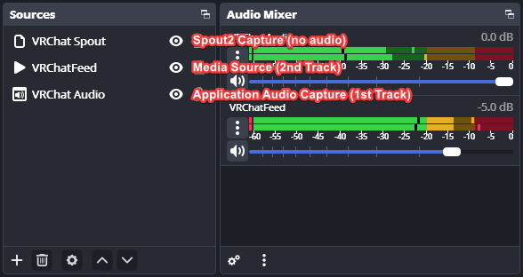

# VaOBS

A Windows tray app that captures videos playing in VRChat through OBS and
automatically delays the clean audio to match VRChat during recording.

## Setup

1. Use Windows x64 and OBS 32.2.2 or newer. Extract the release ZIP, close OBS,
   run `install-plugin.ps1` in PowerShell (as administrator if needed), then restart OBS.
2. Add a Media Source on recording track 2 and VRChat application audio capture
   on track 1. Enable authentication under **Tools → WebSocket Server Settings**.
3. Double-click `vaobs.exe`. Settings opens on first launch. Enter your OBS host,
   port, password, and source names, then click **Save**. The defaults are
   `VRChatFeed` (source to sync) and `VRChatAudio` (timing reference).

Open **Settings** from the tray icon to make changes. VaOBS saves them, reconnects
when OBS becomes available, and protects the saved OBS password with Windows.

VaOBS creates its delayed output automatically on the media feed's recording
tracks and mutes the original feed audio. It keeps the same two recording tracks.
Wait for **Aligned** in the generated source's Properties before recording; a 21-second delay
needs about 27 seconds of shared audio to calibrate. Timing changes take several
seconds to follow. For other scenes, add the existing aligned source and keep
the feed active.

The tray menu also provides **Reconnect**, **Open log**, and **Quit**. To restore
original audio, mute the aligned output and unmute the media feed.



## Build

The Go app is in `cmd/vaobs`; the C++ plugin, tests, and replay tool are in
`obs-plugin`. With Go 1.24+, Git, and PowerShell, run:

```powershell
.\scripts\build-windows.ps1
```

The script builds and tests the Windows ZIP in `dist`. Add `-ObsBinPath` with
your OBS `bin\64bit` directory to run the OBS audio test too.

## License

[GPL-2.0-or-later](LICENSE). Original and third-party notices are retained.

## Support

[Report an issue](https://github.com/Hackebein/VaOBS/issues/new) ·
[Hackebein's Research Lab](https://discord.gg/AqCwGqqQmW)
